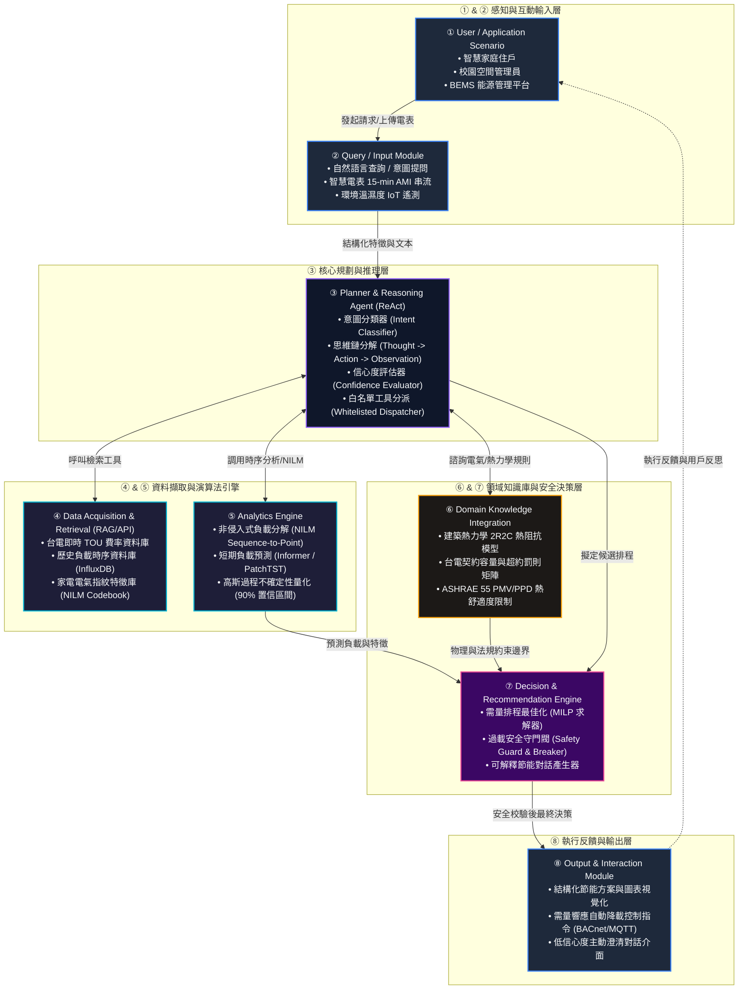

# WattWise AI — 智慧住宅與校園空間用電異常診斷暨需量調度 Domain AI Agent
## 系統設計規格書 (System Architecture & Design Specification)

> **專案定位**：融合生成式 AI 推理 (ReAct Agent)、電力領域知識 (Domain Know-How)、時間序列預測與電氣物理安全約束的垂直領域節能決策系統。  
> **適用情境**：智慧家庭、校園實驗室/行政大樓、中小型商務空間之智慧電能管理系統 (BEMS/HEMS)。

---

## 1. 問題定義與功能需求 (Problem & Functional Requirements)

### 1.1 背景與問題核心 (Core Problem Statement)
隨著極端氣候加劇與能源轉型推動，台灣電力公司（台電）於 2024–2025 年全面實施新版「尖離峰時間電價（Time-of-Use, TOU）」機制，尖離峰電價倍率擴大至 3.5 至 4 倍以上。然而，在一般家庭與大學校園建築中，普遍面臨以下核心困境：
1. **電表遙測資料與用戶認知的「語意鴻溝」**：智慧電表（AMI）僅提供純量時間序列數值（如每 15 分鐘功耗 kWh），一般用戶與管理人員難以推估背後「是哪台設備耗電？是否發生故障？」。
2. **缺乏即時異常診斷與物理情境適配**：傳統能源管理系統（EMS）多停留在固定閾值報警，無法結合當日室外溫濕度、建築熱阻抗（RC 參數）與作息行為進行動態診斷。
3. **通用大語言模型（LLM）的幻覺與安全盲區**：一般對話式 AI 缺乏台灣電價費率規則庫與即時電氣負載計算能力，給出的節能建議脫離實際甚至可能指示關閉核心安防與醫療設備。

### 1.2 系統功能需求 (Functional Requirements: FR-01 至 FR-05)

| 需求編號 | 功能名稱 | 規格細節描述 | 驗收標準與約束 |
| :--- | :--- | :--- | :--- |
| **FR-01** | **用電異常診斷 (Anomaly Diagnostic Reasoning)** | 結合非侵入式電力特徵分解（NILM）與時間序列分位數統計，診斷特定迴路之異常待機功率、頻繁啟停（如壓縮機短週期循環）及功耗畸變。 | 輸出具體異常電器類別、推估額外能耗成本及可解釋的成因分析報告。 |
| **FR-02** | **尖離峰時間電價動態適配 (Dynamic TOU Adaptation)** | 串接台電最新 TOU 費率 API（含夏月/非夏月及尖峰 16:00–22:00 移轉），以小時/分刻度動態規劃具彈性負載設備（儲能、蓄熱熱水器、空調預冷）的充放電與啟閉排程。 | 規劃方案須嚴格遵守台電契約容量紅線，並最大化離峰充電與尖峰抑低效應。 |
| **FR-03** | **低信心度主動澄清迴圈 (Clarification Loop when Confidence < 0.80)** | 當推論引擎對於用戶意圖模糊、設備型態不確定或感測特徵混淆時，計算綜合信心度分數 $C \in [0, 1]$。若 $C < 0.80$，Agent 不得妄下結論，須發起主動引導式追問。 | 提供 2~3 個情境選項引導用戶補齊空間環境參數（如室內人數、是否有大功率電器運轉）。 |
| **FR-04** | **用電過載安全阻斷與主動降級 (Overload Safety Guard & Shedding)** | 建立實時負載安全防護圍欄（Safety Guard）。當總功率預測或即時遙測值達契約容量 90% 臨界值時，觸發第一級降級；達 98% 立即執行白名單安全卸載。 | 嚴禁調用未經白名單授權之外部指令，維生設備（如伺服器機房冷卻、安防照明）列為不可卸載清單。 |
| **FR-05** | **空間環境與熱舒適度適配 (Spatial Thermal Comfort Adaptation)** | 整合一階熱阻熱容（Equivalent Resistance-Capacitance, 1R1C / 2R2C）建築熱力學模型，在空調節能降載決策中納入 Fanger 預測平均熱感（PMV/PPD）約束。 | 任何節能排程調整後，室內預測不滿意百分比（PPD）不得高於 15%，維持基本體感平衡。 |

---

## 2. 八大模組系統架構圖 (Eight-Module Architecture)

WattWise AI 嚴格遵循解耦設計原則，將感知、檢索、推理、領域整合與安全決策劃分為八大模組：



---

## 3. 系統端到端推論流程圖 (End-to-End Decision Flowchart)

系統整合意圖分流、台電 TOU 查詢、歷史電表遙測分析、信心度澄清迴圈（Confidence Threshold = 0.80）以及嚴苛的過載安全檢查：

```mermaid
flowchart TD
    Start([用戶輸入或定時排程觸發]) --> Step1[接收輸入: 自然語言提問 / AMI 遙測資料]
    Step1 --> IntentClassifier{意圖分流判定}
    
    IntentClassifier -->|異常用電診斷| RouteDiag[提取指定迴路時序 & 呼叫 NILM 引擎]
    IntentClassifier -->|尖峰節能調度| RouteSched[檢索明日台電 TOU 尖離峰費率]
    IntentClassifier -->|電費暴增諮詢| RouteBill[調閱歷史 30 天電表底度與氣候溫差]
    IntentClassifier -->|即時過載告警| SafetyCheckImmediate[即時功率與契約容量校驗]

    RouteDiag --> RetrieveData[④ Data Retrieval: 檢索台電費率 + 歷史 15-min AMI 電表]
    RouteSched --> RetrieveData
    RouteBill --> RetrieveData

    RetrieveData --> AnalyticsRun[⑤ 執行 Analytics: 負載時序預測 + 功耗指紋比對]
    AnalyticsRun --> DomainEval[⑥ 結合 Domain: 建築 2R2C 熱阻抗 + PMV 舒適度指標]
    
    DomainEval --> ConfidenceCalc[計算綜合推理信心度 Confidence Score]
    
    ConfidenceCalc --> ConfJudge{Confidence >= 0.80 ?}
    
    ConfJudge -->|否 (< 0.80)| ClarifyLoop[發起澄清迴圈: 向用戶提示 2~3 項情境細節確認<br/>例: 近期是否增設高耗能電暖器或冷凍冷藏庫?]
    ClarifyLoop --> WaitUser[等待用戶補充背景資訊]
    WaitUser --> Step1

    ConfJudge -->|是 (>= 0.80)| CandidatePlan[⑦ Decision Engine: 生成候選調度/節能排程方案]
    
    SafetyCheckImmediate --> SafetyGuard
    CandidatePlan --> SafetyGuard{過載安全檢查守門<br/>Peak Power > 0.90 × 契約容量?}
    
    SafetyGuard -->|是: 具過載跳電風險| SafetyBreaker[觸發安全降級阻斷機制 Safety Breaker<br/>1. 剔除高耗能非關鍵排程<br/>2. 啟用儲能或強制限電階梯<br/>3. 發出紅色安全推播告警]
    SafetyBreaker --> FormatOutput

    SafetyGuard -->|否: 負載位於安全綠區| AcceptPlan[核准節能調度排程與診斷說明]
    AcceptPlan --> FormatOutput[⑧ Output Module: 格式化為自然語言建議、可視化圖表與 IoT 執行指令]

    FormatOutput --> End([交付用戶並監聽執行反饋])
```

---

## 4. 核心演算法虛擬碼 (Algorithm 1: WattWise Domain AI Agent)

以下虛擬碼嚴格按照規範要求，提供 **行號 01 至 25** 之 Python Pseudocode，實作白名單工具呼叫（Whitelisted Tool Dispatcher）、多模態特徵提取、低信心度主動澄清迴圈與過載安全守門降級機制：

```python
01: def wattwise_domain_agent_solve(user_query: str, ami_stream: dict, config: dict) -> dict:
02:     # Step 1: 意圖識別與白名單工具集初始化
03:     intent, target_period = classify_energy_intent(user_query)
04:     whitelisted_tools = ["get_tou_tariffs", "query_smart_meter", "run_nilm_disaggregation", 
05:                          "forecast_load_profile", "evaluate_thermal_comfort", "trigger_safety_breaker"]
06:     # Step 2: 資料檢索與時序特徵工程
07:     tariffs = dispatch_tool("get_tou_tariffs", {"date": target_period.date}, whitelisted_tools)
08:     meter_data = dispatch_tool("query_smart_meter", {"meter_id": config["meter_id"]}, whitelisted_tools)
09:     # Step 3: 分析引擎運算 (NILM 與分位數短期負載預測)
10:     appliance_profiles = dispatch_tool("run_nilm_disaggregation", {"raw_power": meter_data.power}, whitelisted_tools)
11:     forecast_q50, forecast_q90 = dispatch_tool("forecast_load_profile", {"history": meter_data}, whitelisted_tools)
12:     # Step 4: 空間熱力學與環境舒適度適配
13:     thermal_state = dispatch_tool("evaluate_thermal_comfort", {"temp": meter_data.temp, "pmv": config["pmv_target"]}, whitelisted_tools)
14:     # Step 5: 綜合信心度評估與低信心澄清迴圈 (Confidence < 0.80)
15:     confidence_score = compute_reasoning_confidence(appliance_profiles, thermal_state, intent)
16:     if confidence_score < 0.80:
17:         clarification_options = generate_clarification_prompts(intent, appliance_profiles)
18:         return {"status": "CLARIFICATION_REQUIRED", "confidence": confidence_score, "prompt": clarification_options}
19:     # Step 6: 節能調度方案規劃 (MILP 最優化求解)
20:     candidate_schedule = optimize_demand_schedule(appliance_profiles, tariffs, thermal_state)
21:     # Step 7: 過載安全守門檢查迴圈 (Safety Guard Threshold = 90% Contract Capacity)
22:     if max(forecast_q90.values()) >= 0.90 * config["contract_capacity_kw"]:
23:         safe_schedule = dispatch_tool("trigger_safety_breaker", {"plan": candidate_schedule, "limit": config["contract_capacity_kw"]}, whitelisted_tools)
24:         return {"status": "SAFETY_FALLBACK_APPLIED", "schedule": safe_schedule, "warning": "Overload mitigated"}
25:     return {"status": "SUCCESS", "confidence": confidence_score, "schedule": candidate_schedule, "insights": appliance_profiles}
```

---

## 5. 評估計畫與預期效益 (Evaluation Plan & Expected Outcomes)

> **嚴格聲明**：本專案處於期末專題提案階段，**嚴禁填寫或捏造虛假的實測數據結果**。本章節僅明確定立評估方法論、基準數據集（Benchmarks）、量化指標定義與可重複驗證之實驗流程。

### 5.1 評估方法論與基準資料集 (Evaluation Methodology & Benchmarks)
為科學評估 WattWise AI 之效能，專案規劃採用雙軌測試架構：
1. **公開標準資料集 (Public Datasets)**：
   - **REDD (Reference Energy Disaggregation Data Set)**：針對住宅高頻電氣負載分解（NILM）進行特徵萃取準確度測試。
   - **UK-DALE (UK Domestic Appliance-Level Electricity)**：驗證跨季度、多設備混和運轉之異常短週期診斷。
   - **AMPds2 (Almanac of Minutely Power dataset)**：評估 1 分鐘高解析度負載預測與儲能調度。
2. **實體校園與住宅場域場勘驗證 (Field Pilot Setup)**：
   - 校園資訊大樓實驗室（安裝 3 組智慧電表，包含伺服器負載、空調迴路與通用插座）。
   - 示範住宅 1 戶（台電 AMI 15 分鐘遙測連線）。

### 5.2 核心評估指標定義 (Metric Formulations)

1. **短期負載預測精準度 (MAPE / RMSE)**：
   $$\text{MAPE} = \frac{100\%}{N}\sum_{t=1}^{N}\left|\frac{P_{\text{actual}}(t) - \hat{P}_{\text{pred}}(t)}{P_{\text{actual}}(t)}\right|$$
   衡量 24 小時日前預測在尖離峰區間之偏差程度。
2. **異常診斷分類效能 (F1-Score & False Positive Rate)**：
   $$\text{F1} = 2 \cdot \frac{\text{Precision} \cdot \text{Recall}}{\text{Precision} + \text{Recall}}$$
   評估壓縮機老化、異常待機與線路漏電之判斷準確率，降低誤報擾民率。
3. **熱舒適度違規指數 (Thermal Discomfort Index, TDI)**：
   $$\text{TDI} = \sum_{t \in \text{occupied}} \max(0, |\text{PMV}(t)| - 0.5) \cdot \Delta t$$
   檢驗在執行尖峰抑低空調節能時，室內熱舒適度維持在 ASHRAE 55 規範標準以內之程度。
4. **過載攔截成功率 (Safety Interception Rate, SIR)**：
   $$\text{SIR} = \frac{\text{成功降級次數}}{\text{突發過載臨界次數}} \times 100\%$$
   量化在模擬總功率突破契約容量 90% 時，安全守門機制在 3 秒內自動抑制之可靠度。

### 5.3 消融實驗設計 (Ablation Study Architecture)
為探究各模組對系統表現的具體貢獻，將在驗證階段實施四組對照實驗：
- **Model A (Baseline)**：純通用 LLM（未串接電力領域模型與白名單工具，依賴零樣本提示詞）。
- **Model B (Tool-augmented)**：串接電表查詢與台電電價 API，但不具備建築 2R2C 熱阻模型與不確定性預測。
- **Model C (Domain-infused w/o Safety)**：包含完整分析引擎與領域知識庫，但關閉 Safety Guard 守門閥。
- **Model D (WattWise AI Full System)**：完整啟用八大模組、信心度澄清迴圈與安全阻斷降級。

